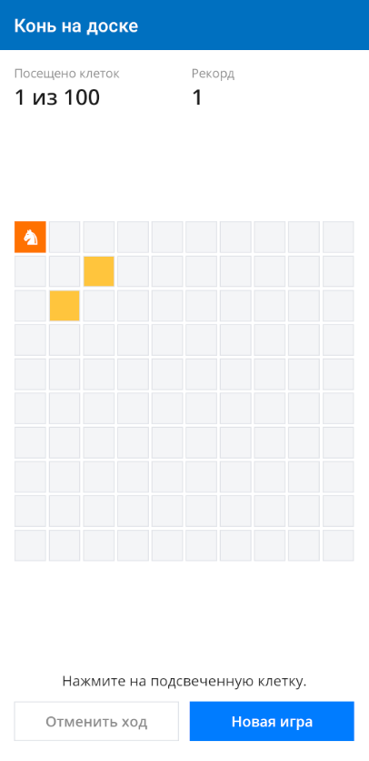
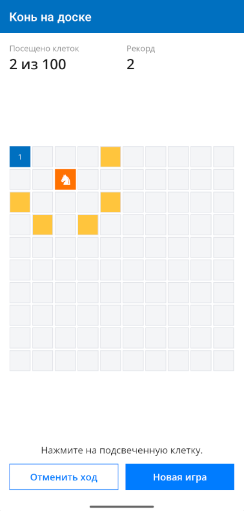
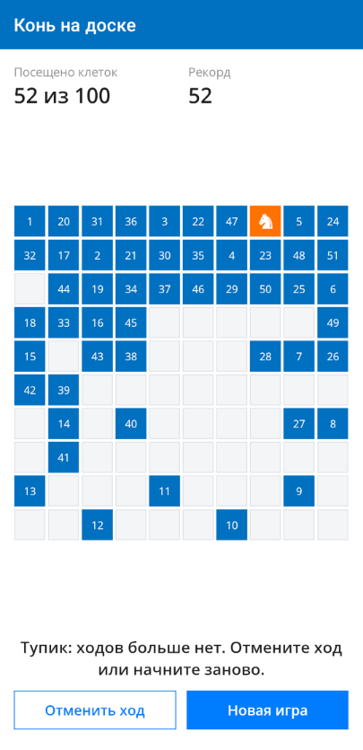

# Конь на доске — .NET MAUI

Игра-головоломка «Конь на доске» для Android на C# и .NET MAUI (.NET 10): шахматный конь должен обойти все 100 клеток поля 10×10, ходя буквой «Г» и не возвращаясь на посещённые клетки.

Это эталонное решение к курсу на Stepik «Простое приложение на C# и MAUI за 12 часов». Версия игры на WPF — в репозитории [Calabonga.HorseOnTheGrid](https://github.com/Calabonga/Calabonga.HorseOnTheGrid).

<p>
  
  
  
</p>

## Правила

1. Поле 10×10, клетки нумеруются с 1, начало координат — левый верхний угол.
2. Партия начинается с коня в клетке x:1, y:1.
3. Конь ходит буквой «Г»: на две клетки в одном направлении и на одну в перпендикулярном.
4. Ходить можно только на клетки, где конь ещё не был.
5. Победа — посещены все 100 клеток; тупик — клетки остались, а ходов нет.

## Возможности

- подсветка клеток, доступных для следующего хода;
- номера ходов на посещённых клетках;
- отмена хода (паттерн «Команда»), в том числе после тупика;
- рекорд, который сохраняется между запусками;
- оформление по фирменной палитре calabonga.net, портретная ориентация.

## Состав решения

| Проект | Назначение |
|---|---|
| `src/Calabonga.HorseOnTheGrid.Core` | ядро игры на .NET 10 без зависимостей от MAUI: позиция, поле, правила хода, состояние партии, история ходов |
| `src/Calabonga.HorseOnTheGrid.Mobile` | приложение .NET MAUI: MVVM на CommunityToolkit.Mvvm, поле на `Grid` и `BindableLayout`, стили и триггеры |
| `tests/Calabonga.HorseOnTheGrid.Core.Tests` | модульные тесты ядра на xUnit, включая проверку, что обход всех 100 клеток существует |

## Требования

- Windows 11;
- Visual Studio 2026 с рабочей нагрузкой «Разработка .NET Multi-platform App UI» — она ставит .NET 10 SDK, Android SDK, OpenJDK и эмулятор;
- эмулятор Android с образом `x86_64` и аппаратным ускорением или телефон с включённой отладкой по USB.

Без Visual Studio подойдёт .NET 10 SDK с рабочей нагрузкой `maui-android` (`dotnet workload install maui-android`).

## Быстрый старт

Команды для PowerShell в Windows Terminal.

```powershell
git clone <адрес-репозитория> Calabonga.HorseOnTheGrid.Maui
cd Calabonga.HorseOnTheGrid.Maui

# 1. Платформенные файлы из шаблона MAUI: иконка, заставка, шрифты, файлы Android.
#    Нужно один раз; если папка src\Calabonga.HorseOnTheGrid.Mobile\Platforms\Android
#    уже содержит AndroidManifest.xml, этот шаг можно пропустить.
pwsh -ExecutionPolicy Bypass -File .\setup.ps1

# 2. Тесты ядра
dotnet test .\tests\Calabonga.HorseOnTheGrid.Core.Tests

# 3. Сборка и запуск на запущенном эмуляторе или подключённом телефоне
dotnet build .\src\Calabonga.HorseOnTheGrid.Mobile -f net10.0-android -t:Run
```

Во время работы `setup.ps1` может появиться ошибка NETSDK1147 — она относится к временному проекту из шаблона и не мешает: скрипт берёт из него только файлы. Существующие файлы проекта скрипт не перезаписывает.

## Запуск в Visual Studio

1. Выполните `setup.ps1` (шаг 1 быстрого старта), если ещё не выполняли.
2. Откройте `Calabonga.HorseOnTheGrid.slnx`.
3. Сделайте запускаемым проект `Calabonga.HorseOnTheGrid.Mobile`.
4. Выберите цель **Android Emulators** или подключённый телефон и нажмите F5.

Первый запуск занимает несколько минут: на устройство устанавливается среда выполнения .NET. Следующие запуски — секунды.

## Сборка подписанного пакета

```powershell
$env:HORSE_KEY_PASS = Read-Host "Пароль хранилища ключей"

dotnet publish .\src\Calabonga.HorseOnTheGrid.Mobile `
    -f net10.0-android -c Release `
    -p:AndroidPackageFormats=apk `
    -p:AndroidKeyStore=true `
    -p:AndroidSigningKeyStore=C:\Keys\horse.keystore `
    -p:AndroidSigningKeyAlias=horse `
    -p:AndroidSigningKeyPass=env:HORSE_KEY_PASS `
    -p:AndroidSigningStorePass=env:HORSE_KEY_PASS
```

Пакет появится в `src\Calabonga.HorseOnTheGrid.Mobile\bin\Release\net10.0-android\publish\` с суффиксом `-Signed.apk`. Хранилище ключей создаётся утилитой `keytool` и хранится вне репозитория.

## Частые проблемы

| Сообщение | Причина | Решение |
|---|---|---|
| `MSB3954: Failed to compute hash for file 'Resources\Splash\splash.svg'` | не выполнен `setup.ps1`, нет файлов из шаблона | выполнить `setup.ps1` |
| `NETSDK1147` при сборке приложения | в `TargetFrameworks` платформа без установленной рабочей нагрузки | оставить `net10.0-android` или установить нагрузку |
| `XA0010: No available device` | не запущен эмулятор и не подключён телефон | запустить эмулятор в Android Device Manager |
| `INSTALL_FAILED_UPDATE_INCOMPATIBLE` | на устройстве версия, подписанная другим ключом | `adb uninstall net.calabonga.horseonthegrid` |
| ошибки путей при сборке | кириллица или пробелы в пути к папке | клонировать в короткий латинский путь, например `C:\Projects` |

## Другие платформы

Проект собирается только для Android. Чтобы добавить Windows, iOS или macOS, установите нужную рабочую нагрузку и допишите платформу в `TargetFrameworks` файла `Calabonga.HorseOnTheGrid.Mobile.csproj` — подсказка есть в комментарии в самом файле. Ядро и модели представления менять не нужно.

## Автор

Calabonga — [calabonga.net](https://www.calabonga.net), курсы на [Stepik](https://stepik.org/users/1295430002/teach).
